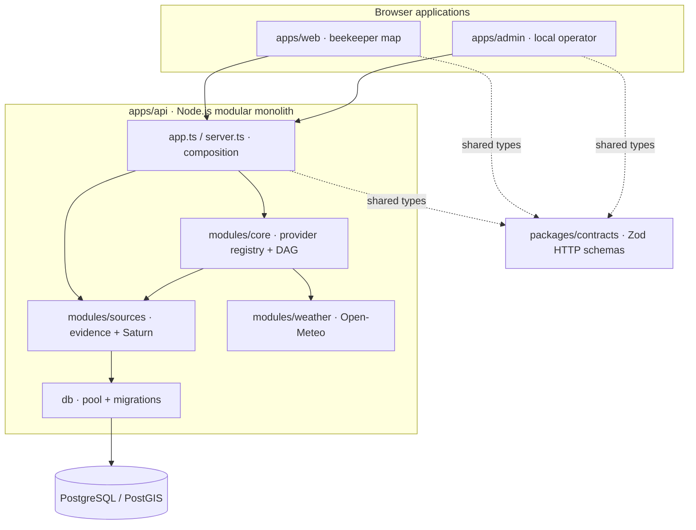
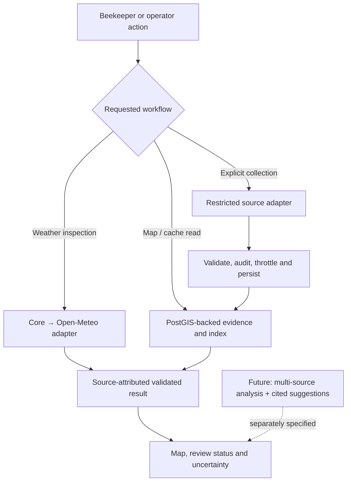

# MelliAtlas

**Evidence-first geospatial intelligence for beekeepers.**

MelliAtlas helps answer three questions: **What is happening around my bees? Where does that information come from? How trustworthy is it?** Agricultural notices, weather, and—eventually—vegetation, flowering periods, and private apiary context belong on one map, with visible source links and uncertainty. Missing evidence must never be presented as proof of safety.

The product is designed for **multiple information providers**, not for a single portal. A modular backend can combine deterministic processing, statistics, ML, and bounded LLM-assisted interpretation as those capabilities are independently specified and verified. The initial orchestration core is a **small internal scaffold**, not a working AI adviser.

## What works today

- **Beekeeper map:** point/radius selection, attributed Open-Meteo weather, and stored source-backed field polygons with explicit `verified` or structured `pending` review status.
- **Local operator workspace:** editable treatment-feed connection, explicit one-page ingestion, original evidence, human review, and a separate preview map.
- **Experimental Saturn viewport index:** cached provider district names/centers, exact-filter index progress, bounded field-center display and one-page manual retrieval behind a server flag. Centers are **not** treatment polygons; collection is disabled by default and does not imply complete district coverage.
- **Backend foundation:** PostgreSQL/PostGIS, restricted source retrieval, immutable document history, a typed provider registry, and a sequential, code-defined DAG runner.

**Not implemented:** private apiary accounts, automatic district refresh, complete agricultural-notice coverage, flowering prediction, hazard assessment, AI-generated relocation points/dates, alerts, or a regional community safety board. These are product directions, not shipped capabilities. The [umbrella specification](docs/specs/active/spec-umbrella-melliatlas.md) and selected [source-ingestion specification](docs/specs/active/subspecs/source-ingestion.md) define the currently approved scope; the broader multi-source migration-planning and community-sharing concepts still require dedicated specifications.

## Modules



Frontend applications do not import backend implementations. Source access, credentials, policy and persistence stay on the server. The admin interface is **localhost-only**, not protected by production-grade authentication.

## How evidence moves



Map navigation and normal notice reads **never start a provider download**. An operator may explicitly import a bounded treatment page; the local Saturn pilot can request a single index page when enabled. The indexed centers and source timestamps must not be interpreted as spraying, safety, or verified field coverage.

## Quick start

Requires Node.js 22, pnpm 11.25.0 and Docker Compose. Full macOS/Linux/Windows instructions: [Installation](docs/INSTALLATION.md).

```bash
pnpm install --frozen-lockfile
cp -n apps/api/.env.example apps/api/.env
docker compose up -d db
pnpm db:migrate
pnpm dev
```

| Application    | Local URL             |
| -------------- | --------------------- |
| Beekeeper web  | http://127.0.0.1:5173 |
| Operator admin | http://127.0.0.1:5174 |
| API            | http://127.0.0.1:3001 |

On subsequent starts, run `docker compose up -d db` and `pnpm dev`; apply new migrations when supplied. Weather and map tiles need internet access. No synthetic readings are substituted during outages.

## Verification

```bash
pnpm format:check
pnpm typecheck
pnpm test
pnpm build
python3 -B tools/specs/validate_state.py
```

Database integration and browser E2E prerequisites are documented in [Tests](docs/TESTS.md). No local or CI check proves third-party data reuse rights or live source coverage.

## Project reference

| Topic                                 | Documentation                                                                                                                            |
| ------------------------------------- | ---------------------------------------------------------------------------------------------------------------------------------------- |
| Product scope and requirements        | [Umbrella spec](docs/specs/active/spec-umbrella-melliatlas.md), [active source sub-spec](docs/specs/active/subspecs/source-ingestion.md) |
| Architecture and actual code          | [Architecture](docs/ARCHITECTURE.md), [Implementation](docs/IMPLEMENTATION.md)                                                           |
| Capability status and delivery        | [Features](docs/FEATURES.md), [Roadmap](docs/ROADMAP.md)                                                                                 |
| Install and use                       | [Installation](docs/INSTALLATION.md), [Usage](docs/USAGE.md)                                                                             |
| Operations and troubleshooting        | [Configuration](docs/CONFIGURATION.md), [Diagnostics](docs/DIAGNOSTIC.md)                                                                |
| Engineering workflow and verification | [Instructions](docs/INSTRUCTIONS.md), [Tests](docs/TESTS.md), [Quality](docs/QUALITY.md)                                                 |
| Repository rules                      | [AGENTS.md](AGENTS.md)                                                                                                                   |

External source behavior, licensing, permissions, and scientific interpretation require independent validation. A manual, non-persisting Saturn connectivity diagnostic is available at `node scripts/check-saturn-api.mjs`; it neither certifies access rights nor establishes current provider availability.
